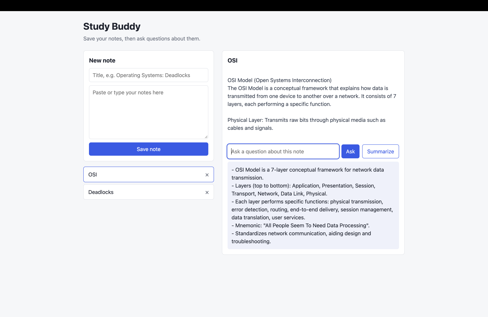

# Study Buddy



A small MERN app. You save study notes, pick one, and ask an AI questions about it
(or click Summarize). Notes are stored in MongoDB. The AI call happens on the server
through the OpenRouter API.

**Live demo:** http://65.2.82.147:5000
*(Hosted on a small AWS EC2 instance that may be stopped to save cost. If the link is down, see the screenshot above or run it locally.)*

**Stack:** MongoDB Atlas, Express, React (Vite), Node.js, OpenRouter (LLM API), AWS EC2, pm2

## Features

- Save, view and delete study notes
- Ask a question about a selected note, answered by an LLM using only that note
- One-click summary of a note as short bullet points
- API key kept on the server, never exposed to the browser

## Run it locally

You need Node 18+ and a MongoDB database (local install or a free MongoDB Atlas cluster).

1. Backend
   ```
   cd server
   npm install
   cp .env.example .env     # then open .env and add your values
   npm run dev
   ```
2. Frontend (in a second terminal)
   ```
   cd client
   npm install
   npm run dev
   ```
3. Open http://localhost:5173

## How it works

1. React sends the note to `POST /api/notes`. Express saves it in MongoDB with Mongoose.
2. When you ask a question, React calls `POST /api/ask` with the note id and the question.
3. The server loads that note from MongoDB, sends the note and question to the LLM,
   and returns the answer.
4. React shows the answer.

The API key is only in the server's `.env`, so the browser never sees it.

## Deployment

The app runs on a single AWS EC2 instance (Amazon Linux 2023, t3.micro):

- `npm run build` in `client` creates the production React files
- Express serves those files and the API from one port (5000)
- pm2 keeps the server running and restarts it after a reboot
- MongoDB Atlas hosts the database, with the server's IP on its allow-list

## Folder guide

- `server/index.js` starts Express, connects to MongoDB, serves the React build
- `server/models/Note.js` shape of a note in the database
- `server/routes/notes.js` save, list and delete notes
- `server/routes/ask.js` the AI call
- `client/src/App.jsx` main component and state
- `client/src/components/` form, list, and ask panel
- `client/src/api.js` all fetch calls in one place

## Possible next steps

- User login with JWT so each person sees only their own notes
- Save the question and answer history for each note
- HTTPS and a custom domain using nginx
